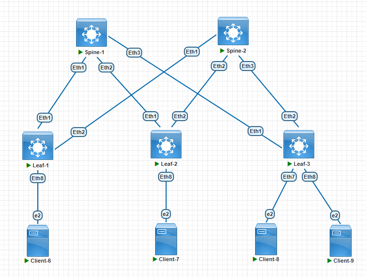

###  Задание:

  1. Настроите ISIS в Underlay сети, для IP связанности между всеми сетевыми устройствами;
  2. Зафиксируете в документации - план работы, адресное пространство, схему сети, конфигурацию устройств;
  3. Убедитесь в наличии IP связанности между устройствами в ISIS домене;

### Решение:

1. Настройка ISIS Underlay слоя сводится к;

    1.1 Запуск и настройка протокола ISIS;
    
    1.2 Назначению IP адресов на интерфейсы связующие устройства, а так же loopback интерфейсов для узлов Leaf;
    
    1.3 Настройки IP интерфейсов, как членов домена ISIS и изменение network type на point-to-point (p2p);



2. План работы
    
    1.1 Назначение IP адресов согласно ранее созданному адресному плану

        | Network IPv4     | Summary net    | Description        | Eq&port Spine/Leaf | Assigned IPs Spine/Leaf     |
        |-----------------:|:---------------|:------------------:|--------------------|-----------------------------|
        | 10.10.1.0/30     | 10.10.0.0/16   | P2P Spine1-Leaf1   | Eth1-Eth1          | 10.10.1.1/10.10.1.2         |
        | 10.10.11.0/30    | 10.10.0.0/16   | P2P Spine2-Leaf1   | Eth1-Eth2          | 10.10.11.1/10.10.11.2       |
        | 10.10.2.0/30     | 10.10.0.0/16   | P2P Spine1-Leaf2   | Eth2-Eth1          | 10.10.2.1/10.10.2.2         |
        | 10.10.12.0/30    | 10.10.0.0/16   | P2P Spine2-Leaf2   | Eth2-Eth2          | 10.10.12.1/10.10.12.2       |
        | 10.10.3.0/30     | 10.10.0.0/16   | P2P Spine1-Leaf3   | Eth3-Eth1          | 10.10.3.1/10.10.3.2         |
        | 10.10.13.0/30    | 10.10.0.0/16   | P2P Spine2-Leaf3   | Eth3-Eth2          | 10.10.13.1/10.10.13.2       |

      Третий октет подразумевает номер Leaf коммутатора. Если видим в третьем октете единицу, то это подключение Leaf1 к Spine1.
      Если видим в третьем октете 11, то это подключение Leaf1 к Spine2 и т.д.

      Таблица сетей для назначения на Loopback интерфейсы:

        | Network IPv4     | Summary net    | Description        | Assigned           |
        |-----------------:|:---------------|:------------------:|--------------------|
        | 1.1.1.1/32       | 1.1.1.0/24     | Loopback0          | Leaf1              |
        | 1.1.1.2/32       | 1.1.1.0/24     | Loopback0          | Leaf2              |
        | 1.1.1.3/32       | 1.1.1.0/24     | Loopback0          | Leaf3              |

    
1.1 Запуск и настройка протокола ISIS

Spine-1:
```
ip routing
!
router isis underlay
   net 49.0010.0010.0001.0001.00
   !
   address-family ipv4 unicast
```

Spine-2:
```
ip routing
!
router isis underlay
   net 49.0001.0001.0001.0002.00
   !
   address-family ipv4 unicast
```

Leaf-1:
```
ip routing
!
router isis underlay
   net 49.0001.0001.0001.0001.00
   !
   address-family ipv4 unicast
```

Leaf-2:
```
ip routing
!
router isis underlay
   net 49.0001.0001.0001.0002.00
   !
   address-family ipv4 unicast
```

Leaf-3:
```
ip routing
!
router isis underlay
   net 49.0001.0001.0001.0003.00
   !
   address-family ipv4 unicast
```


1.2-3 Настройка протокола ISIS на интерфейсах и назначение IP адресов
        
Spine-1:
```
        interface Ethernet1
         description Leaf-1 e1
         mtu 9000
         no switchport
         ip address 10.10.1.1/30
         isis network point-to-point
         isis enable underlay
         !
        interface Ethernet2
         description Leaf-2 e1
         mtu 9000
         no switchport
         ip address 10.10.2.1/30
         isis network point-to-point
         isis enable underlay
         !
        interface Ethernet3
         description Leaf-3 e1
         mtu 9000
         no switchport
         ip address 10.10.3.1/30
         isis network point-to-point
         isis enable underlay
         !
```

Spine-2:
```
        interface Ethernet1
         description Leaf-1 e2
         mtu 9000
         no switchport
         ip address 10.10.11.1/30
         isis network point-to-point
         isis enable underlay
         !
        interface Ethernet2
         description Leaf-2 e2
         mtu 9000
         no switchport
         ip address 10.10.12.1/30
         isis network point-to-point
         isis enable underlay
         !
        interface Ethernet3
         description Leaf-3 e2
         mtu 9000
         no switchport
         ip address 10.10.13.1/30
         isis network point-to-point
         isis enable underlay
         !
```

Leaf-1:
```
        interface Ethernet1
         description Spine-1 e1
         mtu 9000
         no switchport
         ip address 10.10.1.2/30
         isis network point-to-point
         isis enable underlay
         !
        interface Ethernet2
         description Spine-2 e1
         mtu 9000
         no switchport
         ip address 10.10.11.2/30
         isis network point-to-point
         isis enable underlay
         !
        interface Loopback0
         ip address 1.1.1.1/32
         isis enable underlay
```

Leaf-2:
```
        interface Ethernet1
         description Spine-1 e2
         mtu 9000
         no switchport
         ip address 10.10.2.2/30
         isis network point-to-point
         isis enable underlay
         !
        interface Ethernet2
         description Spine-2 e2
         mtu 9000
         no switchport
         ip address 10.10.12.2/30
         isis network point-to-point
         isis enable underlay
         !
        interface Loopback0
         ip address 1.1.1.2/32
         isis enable underlay
```

Leaf-3:
```
        interface Ethernet1
         description Spine-1 e3
         mtu 9000
         no switchport
         ip address 10.10.3.2/30
         isis network point-to-point
         isis enable underlay
         !
        interface Ethernet2
         description Spine-2 e3
         mtu 9000
         no switchport
         ip address 10.10.13.2/30
         isis network point-to-point
         isis enable underlay
         !
        interface Loopback0
         ip address 1.1.1.3/32
         isis enable underlay
```


3. Проверка IP связности между интерфейсами loopback узлов Leaf в ISIS домене

Leaf-1:
```
Leaf-1#sh ip route isis
---more----
 I L2     1.1.1.2/32 [115/30] via 10.10.1.1, Ethernet1
                              via 10.10.11.1, Ethernet2
 I L2     1.1.1.3/32 [115/30] via 10.10.1.1, Ethernet1
                              via 10.10.11.1, Ethernet2
 ---more---

Leaf-1#ping 1.1.1.2 source lo0
PING 1.1.1.2 (1.1.1.2) from 1.1.1.1 : 72(100) bytes of data.
80 bytes from 1.1.1.2: icmp_seq=1 ttl=63 time=6.29 ms
--- 1.1.1.2 ping statistics ---
5 packets transmitted, 5 received, 0% packet loss, time 24ms
rtt min/avg/max/mdev = 3.775/4.870/6.293/0.948 ms, ipg/ewma 6.177/5.555 ms

Leaf-1#ping 1.1.1.3 source lo0
PING 1.1.1.3 (1.1.1.3) from 1.1.1.1 : 72(100) bytes of data.
80 bytes from 1.1.1.3: icmp_seq=1 ttl=63 time=6.20 ms
--- 1.1.1.3 ping statistics ---
5 packets transmitted, 5 received, 0% packet loss, time 25ms
rtt min/avg/max/mdev = 4.123/4.606/6.200/0.801 ms, ipg/ewma 6.446/5.372 ms
```

Leaf-2:
```
Leaf-2#sh ip route isis

---more---

 I L2     1.1.1.1/32 [115/30] via 10.10.2.1, Ethernet1
                              via 10.10.12.1, Ethernet2
 I L2     1.1.1.3/32 [115/30] via 10.10.2.1, Ethernet1
                              via 10.10.12.1, Ethernet2
 
Leaf-2#ping 1.1.1.1 source lo0
PING 1.1.1.1 (1.1.1.1) from 1.1.1.2 : 72(100) bytes of data.
80 bytes from 1.1.1.1: icmp_seq=1 ttl=63 time=5.84 ms
--- 1.1.1.1 ping statistics ---
5 packets transmitted, 5 received, 0% packet loss, time 22ms
rtt min/avg/max/mdev = 3.619/4.129/5.844/0.859 ms, ipg/ewma 5.552/4.954 ms

Leaf-2#ping 1.1.1.3 source lo0
PING 1.1.1.3 (1.1.1.3) from 1.1.1.2 : 72(100) bytes of data.
80 bytes from 1.1.1.3: icmp_seq=1 ttl=63 time=6.05 ms
--- 1.1.1.3 ping statistics ---
5 packets transmitted, 5 received, 0% packet loss, time 23ms
rtt min/avg/max/mdev = 3.931/5.496/9.421/2.118 ms, ipg/ewma 5.856/5.881 ms
```

Leaf-3:
```
Leaf-3#sh ip route isis
 I L2     1.1.1.1/32 [115/30] via 10.10.3.1, Ethernet1
                              via 10.10.13.1, Ethernet2
 I L2     1.1.1.2/32 [115/30] via 10.10.3.1, Ethernet1
                              via 10.10.13.1, Ethernet2

Leaf-3#ping 1.1.1.1 source lo0
PING 1.1.1.1 (1.1.1.1) from 1.1.1.3 : 72(100) bytes of data.
80 bytes from 1.1.1.1: icmp_seq=1 ttl=63 time=6.17 ms
--- 1.1.1.1 ping statistics ---
5 packets transmitted, 5 received, 0% packet loss, time 23ms
rtt min/avg/max/mdev = 3.743/4.347/6.176/0.920 ms, ipg/ewma 5.886/5.225 ms

Leaf-3#ping 1.1.1.2 source lo0
PING 1.1.1.2 (1.1.1.2) from 1.1.1.3 : 72(100) bytes of data.
80 bytes from 1.1.1.2: icmp_seq=1 ttl=63 time=5.79 ms
--- 1.1.1.2 ping statistics ---
5 packets transmitted, 5 received, 0% packet loss, time 22ms
rtt min/avg/max/mdev = 3.818/4.515/5.792/0.814 ms, ipg/ewma 5.648/5.137 ms
```

[Конфигурационные файлы](configs/)