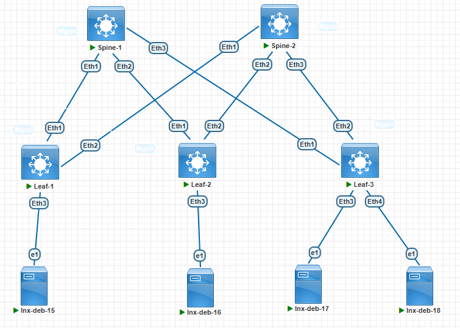

###  Задание:

  1. Настройте BGP peering между Leaf и Spine узлами в AF l2vpn evpn;
  2. Настройте связность между клиентами в первой зоне;
  3. Убедитесь в наличии связности между хостами в одной зоне подключенных к фабрике.
  4. Зафиксируете в документации - план работы, адресное пространство, схему сети, конфигурацию устройств;

### Решение:

1. Настройка Overlay слоя между Leaf и Spine сводится к;

    1.1 Создание дополнительного Address Family (EVPN), настройка его опций, новых peer, а так же настройка необходимых VNI и назначение необходимых RD/RT на узлах Leaf;
    
    1.2 Настройка интерфейса VXLAN на узлах Leaf;    



2. План работы
    
    1.1 Назначение IP адресов согласно ранее созданному адресному плану

        | Network IPv4     | Summary net    | Description        | Eq&port Spine/Leaf | Assigned IPs Spine/Leaf     |
        |-----------------:|:---------------|:------------------:|--------------------|-----------------------------|
        | 10.10.1.0/30     | 10.10.0.0/16   | P2P Spine1-Leaf1   | Eth1-Eth1          | 10.10.1.1/10.10.1.2         |
        | 10.10.11.0/30    | 10.10.0.0/16   | P2P Spine2-Leaf1   | Eth1-Eth2          | 10.10.11.1/10.10.11.2       |
        | 10.10.2.0/30     | 10.10.0.0/16   | P2P Spine1-Leaf2   | Eth2-Eth1          | 10.10.2.1/10.10.2.2         |
        | 10.10.12.0/30    | 10.10.0.0/16   | P2P Spine2-Leaf2   | Eth2-Eth2          | 10.10.12.1/10.10.12.2       |
        | 10.10.3.0/30     | 10.10.0.0/16   | P2P Spine1-Leaf3   | Eth3-Eth1          | 10.10.3.1/10.10.3.2         |
        | 10.10.13.0/30    | 10.10.0.0/16   | P2P Spine2-Leaf3   | Eth3-Eth2          | 10.10.13.1/10.10.13.2       |

      Третий октет подразумевает номер Leaf коммутатора. Если видим в третьем октете единицу, то это подключение Leaf1 к Spine1.
      Если видим в третьем октете 11, то это подключение Leaf1 к Spine2 и т.д.

      Таблица сетей для назначения на Loopback интерфейсы:

        | Network IPv4      | Summary net    | Description        | Assigned           |
        |------------------:|:---------------|:------------------:|--------------------|
        | 1.1.1.1/32        | 1.1.1.0/24     | Loopback0          | Leaf1              |
        | 1.1.1.2/32        | 1.1.1.0/24     | Loopback0          | Leaf2              |
        | 1.1.1.3/32        | 1.1.1.0/24     | Loopback0          | Leaf3              |
        | 100.100.100.100/32|       -        | Loopback0          | Spine1             |
        | 200.200.200.200/32|       -        | Loopback0          | Spine2             |

      Таблица номеров автономных систем BGP для каждого устройства:
         
         | Device             | Router-ID        | AS Number    |
         |--------------------|-----------------:|--------------|
         | Spine1             | 10.10.1.1        | 65100        |
         | Spine2             | 10.10.11.1       | 65100        |
         | Leaf1              | 1.1.1.1          | 65001        |
         | Leaf2              | 1.1.1.2          | 65002        |
         | Leaf3              | 1.1.1.3          | 65003        |

      Хосты подключенные к фабрике:

        | Hostname      | Ip Address       | VLAN/VNI    | Connect to interface  | MAC Address    |
        |--------------:|:-----------------|:-----------:|-----------------------|----------------|
        | lnx-deb-15    | 192.168.10.15/24 | 10/10010    | Leaf1 Eth3            | 50bb.4401.5f01 |
        | lnx-deb-16    | 192.168.10.16/24 | 10/10010    | Leaf2 Eth3            | 50de.a401.6001 |
        | lnx-deb-17    | 192.168.10.17/24 | 10/10010    | Leaf3 Eth3            | 50ec.6b01.6101 |
        | lnx-deb-18    | 192.168.20.18/24 | 20/10020    | Leaf3 Eth4            | 5040.dd01.6201 |
 
    
1.1 Настройка протокола BGP для организации Overlay слоя в Address Family l2vpn evpn, а так же настройка необходимых VNI и назначение необходимых RD/RT на узлах Leaf

Spine-1:
```
service routing protocols model multi-agent
ip routing
!
router bgp 65100
   router-id 10.10.1.1
   neighbor ovl peer group
   neighbor ovl update-source Loopback0
   neighbor ovl ebgp-multihop 3
   neighbor ovl send-community extended
   neighbor 1.1.1.1 peer group ovl
   neighbor 1.1.1.1 remote-as 65001
   neighbor 1.1.1.2 peer group ovl
   neighbor 1.1.1.2 remote-as 65002
   neighbor 1.1.1.3 peer group ovl
   neighbor 1.1.1.3 remote-as 65003
   neighbor 10.10.1.2 remote-as 65001
   neighbor 10.10.1.2 send-community
   neighbor 10.10.2.2 remote-as 65002
   neighbor 10.10.2.2 send-community
   neighbor 10.10.3.2 remote-as 65003
   neighbor 10.10.3.2 send-community
   !
   address-family evpn
      neighbor ovl next-hop-unchanged
      neighbor 1.1.1.1 activate
      neighbor 1.1.1.2 activate
      neighbor 1.1.1.3 activate
   !
   address-family ipv4
      neighbor 10.10.1.2 activate
      neighbor 10.10.2.2 activate
      neighbor 10.10.3.2 activate
      network 100.100.100.100/32
```

Spine-2:
```
service routing protocols model multi-agent
ip routing
!
router bgp 65100
   router-id 10.10.11.1
   neighbor ovl peer group
   neighbor ovl update-source Loopback0
   neighbor ovl ebgp-multihop 3
   neighbor ovl send-community extended
   neighbor 1.1.1.1 peer group ovl
   neighbor 1.1.1.1 remote-as 65001
   neighbor 1.1.1.2 peer group ovl
   neighbor 1.1.1.2 remote-as 65002
   neighbor 1.1.1.3 peer group ovl
   neighbor 1.1.1.3 remote-as 65003
   neighbor 10.10.11.2 remote-as 65001
   neighbor 10.10.11.2 send-community
   neighbor 10.10.12.2 remote-as 65002
   neighbor 10.10.12.2 send-community
   neighbor 10.10.13.2 remote-as 65003
   neighbor 10.10.13.2 send-community
   !
   address-family evpn
      neighbor ovl next-hop-unchanged
      neighbor 1.1.1.1 activate
      neighbor 1.1.1.2 activate
      neighbor 1.1.1.3 activate
   !
   address-family ipv4
      neighbor 10.10.11.2 activate
      neighbor 10.10.12.2 activate
      neighbor 10.10.13.2 activate
      network 200.200.200.200/32
```

Leaf-1:
```
service routing protocols model multi-agent
ip routing
!
router bgp 65001
   router-id 1.1.1.1
   maximum-paths 8
   neighbor sp1-ovl peer group
   neighbor sp1-ovl remote-as 65100
   neighbor sp1-ovl update-source Loopback0
   neighbor sp1-ovl ebgp-multihop 4
   neighbor sp1-ovl send-community extended
   neighbor 10.10.1.1 remote-as 65100
   neighbor 10.10.11.1 remote-as 65100
   neighbor 100.100.100.100 peer group sp1-ovl
   neighbor 200.200.200.200 peer group sp1-ovl
   !
   vlan 10
      rd 1.1.1.1:10
      route-target both 65100:10010
      redistribute learned
   !
   vlan 20
      rd 1.1.1.1:20
      route-target both 65100:10020
      redistribute learned
   !
   address-family evpn
      neighbor sp1-ovl activate
   !
   address-family ipv4
      neighbor 10.10.1.1 activate
      neighbor 10.10.11.1 activate
      network 1.1.1.1/32
```

Leaf-2:
```
service routing protocols model multi-agent
ip routing
!
router bgp 65002
   router-id 1.1.1.2
   maximum-paths 8
   neighbor sp1-ovl peer group
   neighbor sp1-ovl remote-as 65100
   neighbor sp1-ovl update-source Loopback0
   neighbor sp1-ovl ebgp-multihop 4
   neighbor sp1-ovl send-community extended
   neighbor 10.10.2.1 remote-as 65100
   neighbor 10.10.12.1 remote-as 65100
   neighbor 100.100.100.100 peer group sp1-ovl
   neighbor 200.200.200.200 peer group sp1-ovl
   !
   vlan 10
      rd 1.1.1.2:10
      route-target both 65100:10010
      redistribute learned
   !
   vlan 20
      rd 1.1.1.2:20
      route-target both 65100:10020
      redistribute learned
   !
   address-family evpn
      neighbor sp1-ovl activate
   !
   address-family ipv4
      neighbor 10.10.2.1 activate
      neighbor 10.10.12.1 activate
      network 1.1.1.2/32
```

Leaf-3:
```
service routing protocols model multi-agent
ip routing
!
router bgp 65003
   router-id 1.1.1.3
   maximum-paths 8
   neighbor sp1-ovl peer group
   neighbor sp1-ovl remote-as 65100
   neighbor sp1-ovl update-source Loopback0
   neighbor sp1-ovl ebgp-multihop 4
   neighbor sp1-ovl send-community extended
   neighbor 10.10.3.1 remote-as 65100
   neighbor 10.10.13.1 remote-as 65100
   neighbor 100.100.100.100 peer group sp1-ovl
   neighbor 200.200.200.200 peer group sp1-ovl
   !
   vlan 10
      rd 1.1.1.3:10
      route-target both 65100:10010
      redistribute learned
   !
   vlan 20
      rd 1.1.1.3:20
      route-target both 65100:10020
      redistribute learned
   !
   address-family evpn
      neighbor sp1-ovl activate
   !
   address-family ipv4
      neighbor 10.10.3.1 activate
      neighbor 10.10.13.1 activate
      network 1.1.1.3/32
```


1.2 Настройка интерфейса VXLAN на всех узлах выполняется идентично.
        
Leaf-1,2,3:
```
interface Vxlan1
   vxlan source-interface Loopback0
   vxlan udp-port 4789
   vxlan vlan 10 vni 10010
   vxlan vlan 20 vni 10020
```

3. Проверка IP связности между хостами подключенными к фабрике в одной зоне (VLAN/VNI), а так же вывод имеющихся маршрутов MAC-IP на Leaf коммутаторах

Leaf-1:
```
Leaf-1#sh bgp evpn route-type mac-ip
BGP routing table information for VRF default
Router identifier 1.1.1.1, local AS number 65001
Route status codes: * - valid, > - active, S - Stale, E - ECMP head, e - ECMP
                    c - Contributing to ECMP, % - Pending BGP convergence
Origin codes: i - IGP, e - EGP, ? - incomplete
AS Path Attributes: Or-ID - Originator ID, C-LST - Cluster List, LL Nexthop - Link Local Nexthop

          Network                Next Hop              Metric  LocPref Weight  Path
 * >      RD: 1.1.1.1:10 mac-ip 50bb.4401.5f01
                                 -                     -       -       0       i
 * >Ec    RD: 1.1.1.2:10 mac-ip 50de.a401.6001
                                 1.1.1.2               -       100     0       65100 65002 i
 *  ec    RD: 1.1.1.2:10 mac-ip 50de.a401.6001
                                 1.1.1.2               -       100     0       65100 65002 i
 * >Ec    RD: 1.1.1.3:10 mac-ip 50ec.6b01.6101
                                 1.1.1.3               -       100     0       65100 65003 i
 *  ec    RD: 1.1.1.3:10 mac-ip 50ec.6b01.6101
                                 1.1.1.3               -       100     0       65100 65003 i
```

Leaf-2:
```
Leaf-2#sh bgp evpn route-type mac-ip
BGP routing table information for VRF default
Router identifier 1.1.1.2, local AS number 65002
Route status codes: * - valid, > - active, S - Stale, E - ECMP head, e - ECMP
                    c - Contributing to ECMP, % - Pending BGP convergence
Origin codes: i - IGP, e - EGP, ? - incomplete
AS Path Attributes: Or-ID - Originator ID, C-LST - Cluster List, LL Nexthop - Link Local Nexthop

          Network                Next Hop              Metric  LocPref Weight  Path
 * >Ec    RD: 1.1.1.1:10 mac-ip 50bb.4401.5f01
                                 1.1.1.1               -       100     0       65100 65001 i
 *  ec    RD: 1.1.1.1:10 mac-ip 50bb.4401.5f01
                                 1.1.1.1               -       100     0       65100 65001 i
 * >      RD: 1.1.1.2:10 mac-ip 50de.a401.6001
                                 -                     -       -       0       i
 * >Ec    RD: 1.1.1.3:10 mac-ip 50ec.6b01.6101
                                 1.1.1.3               -       100     0       65100 65003 i
 *  ec    RD: 1.1.1.3:10 mac-ip 50ec.6b01.6101
                                 1.1.1.3               -       100     0       65100 65003 i
```

Leaf-3:
```
Leaf-3#sh bgp evpn route-type mac-ip
BGP routing table information for VRF default
Router identifier 1.1.1.3, local AS number 65003
Route status codes: * - valid, > - active, S - Stale, E - ECMP head, e - ECMP
                    c - Contributing to ECMP, % - Pending BGP convergence
Origin codes: i - IGP, e - EGP, ? - incomplete
AS Path Attributes: Or-ID - Originator ID, C-LST - Cluster List, LL Nexthop - Link Local Nexthop

          Network                Next Hop              Metric  LocPref Weight  Path
 * >Ec    RD: 1.1.1.1:10 mac-ip 50bb.4401.5f01
                                 1.1.1.1               -       100     0       65100 65001 i
 *  ec    RD: 1.1.1.1:10 mac-ip 50bb.4401.5f01
                                 1.1.1.1               -       100     0       65100 65001 i
 * >Ec    RD: 1.1.1.2:10 mac-ip 50de.a401.6001
                                 1.1.1.2               -       100     0       65100 65002 i
 *  ec    RD: 1.1.1.2:10 mac-ip 50de.a401.6001
                                 1.1.1.2               -       100     0       65100 65002 i
 * >      RD: 1.1.1.3:10 mac-ip 50ec.6b01.6101
                                 -                     -       -       0       i
```
Проверка доступности между хостами. Так как Ping это двухсторонняя проверка, то достаточно провести тест с одного хоста и пропинговать каждый удаленный:
```
root@lnx-deb-15:~# ip addr show ens4
3: ens4: <BROADCAST,MULTICAST,UP,LOWER_UP> mtu 1500 qdisc fq_codel state UP group default qlen 1000
    link/ether 50:bb:44:01:5f:01 brd ff:ff:ff:ff:ff:ff
    altname enp0s4
    inet 192.168.10.15/24 scope global ens4
       valid_lft forever preferred_lft forever
    inet6 fe80::52bb:44ff:fe01:5f01/64 scope link
       valid_lft forever preferred_lft forever

root@lnx-deb-15:~# ping 192.168.10.16
PING 192.168.10.16 (192.168.10.16) 56(84) bytes of data.
64 bytes from 192.168.10.16: icmp_seq=2 ttl=64 time=11.3 ms
64 bytes from 192.168.10.16: icmp_seq=3 ttl=64 time=12.0 ms
64 bytes from 192.168.10.16: icmp_seq=4 ttl=64 time=12.2 ms
^C
--- 192.168.10.16 ping statistics ---
3 packets transmitted, 3 received, 0% packet loss, time 3026ms
rtt min/avg/max/mdev = 11.261/11.799/12.169/0.389 ms
root@lnx-deb-15:~# ping 192.168.10.17
PING 192.168.10.17 (192.168.10.17) 56(84) bytes of data.
64 bytes from 192.168.10.17: icmp_seq=1 ttl=64 time=24.3 ms
64 bytes from 192.168.10.17: icmp_seq=2 ttl=64 time=14.1 ms
64 bytes from 192.168.10.17: icmp_seq=3 ttl=64 time=13.0 ms
^C
--- 192.168.10.17 ping statistics ---
3 packets transmitted, 3 received, 0% packet loss, time 2003ms
rtt min/avg/max/mdev = 12.953/17.123/24.315/5.106 ms
```

[Конфигурационные файлы](configs/)