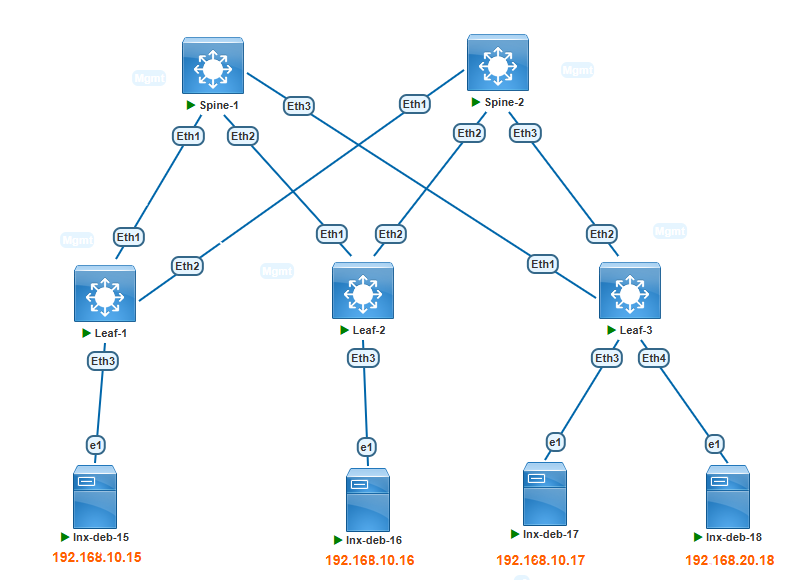

###  Задание:

  1. Настроите каждого клиента в своем VNI;
  2. Настроите маршрутизацию между клиентами;
  3. Убедитесь в наличии связности между хостами в разных зонах подключенных к фабрике.
  4. Зафиксируете в документации - план работы, адресное пространство, схему сети, конфигурацию устройств;

### Решение:

1. Концепция для inter-vlan роутинга выбрана следующая - на всех leaf использовать Anycast-Gateway и использования Symmetric IRB (Distributed Symmetric IRB Anycast-Gateway VTEP);

    1.1 Создание дополнительного VRF для L3VNI на Leaf узлах, создание MAC адреса для использования на Anycast-Gateway интерфейсах;
    
    1.2 Создание SVI интерфейсов для всех необходимых зон (vlan), назначить IP anycast адреса, добавить эти интерфейсы в созданный ранее VRF;

    1.3 Настройка BGP и интерфейса VXLAN для работы L3VNI (Symmetric IRB)



2. План работы
    
    1.1 Назначение IP адресов согласно ранее созданному адресному плану

        | Network IPv4     | Summary net    | Description        | Eq&port Spine/Leaf | Assigned IPs Spine/Leaf     |
        |-----------------:|:---------------|:------------------:|--------------------|-----------------------------|
        | 10.10.1.0/30     | 10.10.0.0/16   | P2P Spine1-Leaf1   | Eth1-Eth1          | 10.10.1.1/10.10.1.2         |
        | 10.10.11.0/30    | 10.10.0.0/16   | P2P Spine2-Leaf1   | Eth1-Eth2          | 10.10.11.1/10.10.11.2       |
        | 10.10.2.0/30     | 10.10.0.0/16   | P2P Spine1-Leaf2   | Eth2-Eth1          | 10.10.2.1/10.10.2.2         |
        | 10.10.12.0/30    | 10.10.0.0/16   | P2P Spine2-Leaf2   | Eth2-Eth2          | 10.10.12.1/10.10.12.2       |
        | 10.10.3.0/30     | 10.10.0.0/16   | P2P Spine1-Leaf3   | Eth3-Eth1          | 10.10.3.1/10.10.3.2         |
        | 10.10.13.0/30    | 10.10.0.0/16   | P2P Spine2-Leaf3   | Eth3-Eth2          | 10.10.13.1/10.10.13.2       |

      Третий октет подразумевает номер Leaf коммутатора. Если видим в третьем октете единицу, то это подключение Leaf1 к Spine1.
      Если видим в третьем октете 11, то это подключение Leaf1 к Spine2 и т.д.

      Таблица сетей для назначения на Loopback интерфейсы:

        | Network IPv4      | Summary net    | Description        | Assigned           |
        |------------------:|:---------------|:------------------:|--------------------|
        | 1.1.1.1/32        | 1.1.1.0/24     | Loopback0          | Leaf1              |
        | 1.1.1.2/32        | 1.1.1.0/24     | Loopback0          | Leaf2              |
        | 1.1.1.3/32        | 1.1.1.0/24     | Loopback0          | Leaf3              |
        | 100.100.100.100/32|       -        | Loopback0          | Spine1             |
        | 200.200.200.200/32|       -        | Loopback0          | Spine2             |

      Таблица номеров автономных систем BGP для каждого устройства:
         
         | Device             | Router-ID        | AS Number    |
         |--------------------|-----------------:|--------------|
         | Spine1             | 10.10.1.1        | 65100        |
         | Spine2             | 10.10.11.1       | 65100        |
         | Leaf1              | 1.1.1.1          | 65001        |
         | Leaf2              | 1.1.1.2          | 65002        |
         | Leaf3              | 1.1.1.3          | 65003        |

      Хосты подключенные к фабрике:

        | Hostname      | Ip Address       | VLAN/VNI    | Connect to interface  | MAC Address    |
        |--------------:|:-----------------|:-----------:|-----------------------|----------------|
        | lnx-deb-15    | 192.168.10.15/24 | 10/10010    | Leaf1 Eth3            | 50bb.4401.5f01 |
        | lnx-deb-16    | 192.168.10.16/24 | 10/10010    | Leaf2 Eth3            | 50de.a401.6001 |
        | lnx-deb-17    | 192.168.10.17/24 | 10/10010    | Leaf3 Eth3            | 50ec.6b01.6101 |
        | lnx-deb-18    | 192.168.20.18/24 | 20/10020    | Leaf3 Eth4            | 5040.dd01.6201 |
 
    


1.1 Создание дополнительного VRF для L3VNI на Leaf узлах, создание MAC адреса для использования на Anycast-Gateway интерфейсах:

Leaf1-3:
```
vrf instance TENANT-A
ip routing vrf TENANT-A
!
ip virtual-router mac-address 00:00:22:22:33:33
!

```

1.2 Создание SVI интерфейсов для всех необходимых зон (vlan), назначить IP anycast адреса, добавить эти интерфейсы в созданный ранее VRF:
        
Leaf1-3:
```
interface Vlan10
   vrf TENANT-A
   ip address virtual 192.168.10.1/24
!
interface Vlan20
   vrf TENANT-A
   ip address virtual 192.168.20.1/24

```

1.3 Настройка BGP и интерфейса VXLAN для работы L3VNI (Symmetric IRB)

Leaf1-3:
```
interface Vxlan1
   vxlan vrf TENANT-A vni 50001

router bgp <self as-number>
vrf TENANT-A
      rd <self_ip-of-loopback0>:50001
      route-target import evpn 65100:50001
      route-target export evpn 65100:50001
      redistribute connected

```
Проверка доступности между хостами. Так как Ping это двухсторонняя проверка, то достаточно провести тест с одного хоста и пропинговать каждый удаленный:
```
root@lnx-deb-18:~# ip addr show dev ens4
3: ens4: <BROADCAST,MULTICAST,UP,LOWER_UP> mtu 1500 qdisc fq_codel state UP group default qlen 1000
    link/ether 50:40:dd:01:62:01 brd ff:ff:ff:ff:ff:ff
    altname enp0s4
    inet 192.168.20.18/24 scope global ens4
       valid_lft forever preferred_lft forever
    inet6 fe80::5240:ddff:fe01:6201/64 scope link
       valid_lft forever preferred_lft forever

root@lnx-deb-18:~# ping 192.168.10.17 -c 3
PING 192.168.10.17 (192.168.10.17) 56(84) bytes of data.
64 bytes from 192.168.10.17: icmp_seq=1 ttl=63 time=15.9 ms
64 bytes from 192.168.10.17: icmp_seq=2 ttl=63 time=6.22 ms
64 bytes from 192.168.10.17: icmp_seq=3 ttl=63 time=4.80 ms

--- 192.168.10.17 ping statistics ---
3 packets transmitted, 3 received, 0% packet loss, time 2003ms
rtt min/avg/max/mdev = 4.804/8.959/15.860/4.913 ms
root@lnx-deb-18:~#
root@lnx-deb-18:~# ping 192.168.10.16 -c 3
PING 192.168.10.16 (192.168.10.16) 56(84) bytes of data.
64 bytes from 192.168.10.16: icmp_seq=1 ttl=62 time=117 ms
64 bytes from 192.168.10.16: icmp_seq=2 ttl=62 time=12.7 ms
64 bytes from 192.168.10.16: icmp_seq=3 ttl=62 time=13.0 ms

--- 192.168.10.16 ping statistics ---
3 packets transmitted, 3 received, 0% packet loss, time 2003ms
rtt min/avg/max/mdev = 12.678/47.395/116.558/48.905 ms
root@lnx-deb-18:~# ping 192.168.10.15 -c 3
PING 192.168.10.15 (192.168.10.15) 56(84) bytes of data.
64 bytes from 192.168.10.15: icmp_seq=1 ttl=62 time=115 ms
64 bytes from 192.168.10.15: icmp_seq=2 ttl=62 time=11.8 ms
64 bytes from 192.168.10.15: icmp_seq=3 ttl=62 time=11.5 ms

--- 192.168.10.15 ping statistics ---
3 packets transmitted, 3 received, 0% packet loss, time 2004ms
rtt min/avg/max/mdev = 11.512/46.038/114.802/48.623 ms
```

[Конфигурационные файлы](configs/)