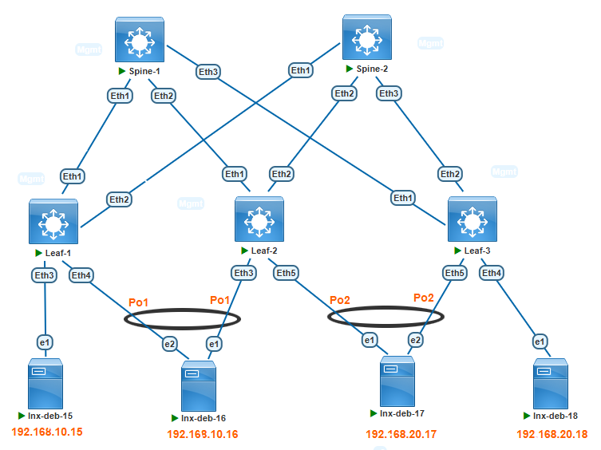

###  Задание:

  1. Подключите клиентов 2-я линками к различным Leaf;
  2. Настроите агрегированный канал со стороны клиента;
  3. Настроите multihoming для работы в Overlay сети. Если используете Cisco NXOS - vPC, если иной вендор - то ESI LAG (либо MC-LAG с поддержкой VXLAN).
  4. Зафиксируете в документации - план работы, адресное пространство, схему сети, конфигурацию устройств;
  5. Опционально - протестировать отказоустойчивость - убедиться, что связнность не теряется при отключении одного из линков;

### Решение:

1. Организовать дополнительные подключения к Leaf узлам для серверов lnx-deb-16 и lnx-deb-16;
2. Настроить на упомянутых серверах агрегацию линков с использованием протокола LACP
3. Выполнить необходимые настройки на Leaf узлах для организации Multihoming (ESI LAG) подключений к серверам.



2. План работы
    
    1.1 Назначение IP адресов согласно ранее созданному адресному плану

        | Network IPv4     | Summary net    | Description        | Eq&port Spine/Leaf | Assigned IPs Spine/Leaf     |
        |-----------------:|:---------------|:------------------:|--------------------|-----------------------------|
        | 10.10.1.0/30     | 10.10.0.0/16   | P2P Spine1-Leaf1   | Eth1-Eth1          | 10.10.1.1/10.10.1.2         |
        | 10.10.11.0/30    | 10.10.0.0/16   | P2P Spine2-Leaf1   | Eth1-Eth2          | 10.10.11.1/10.10.11.2       |
        | 10.10.2.0/30     | 10.10.0.0/16   | P2P Spine1-Leaf2   | Eth2-Eth1          | 10.10.2.1/10.10.2.2         |
        | 10.10.12.0/30    | 10.10.0.0/16   | P2P Spine2-Leaf2   | Eth2-Eth2          | 10.10.12.1/10.10.12.2       |
        | 10.10.3.0/30     | 10.10.0.0/16   | P2P Spine1-Leaf3   | Eth3-Eth1          | 10.10.3.1/10.10.3.2         |
        | 10.10.13.0/30    | 10.10.0.0/16   | P2P Spine2-Leaf3   | Eth3-Eth2          | 10.10.13.1/10.10.13.2       |

      Третий октет подразумевает номер Leaf коммутатора. Если видим в третьем октете единицу, то это подключение Leaf1 к Spine1.
      Если видим в третьем октете 11, то это подключение Leaf1 к Spine2 и т.д.

      Таблица сетей для назначения на Loopback интерфейсы:

        | Network IPv4      | Summary net    | Description        | Assigned           |
        |------------------:|:---------------|:------------------:|--------------------|
        | 1.1.1.1/32        | 1.1.1.0/24     | Loopback0          | Leaf1              |
        | 1.1.1.2/32        | 1.1.1.0/24     | Loopback0          | Leaf2              |
        | 1.1.1.3/32        | 1.1.1.0/24     | Loopback0          | Leaf3              |
        | 100.100.100.100/32|       -        | Loopback0          | Spine1             |
        | 200.200.200.200/32|       -        | Loopback0          | Spine2             |

      Таблица номеров автономных систем BGP для каждого устройства:
         
         | Device             | Router-ID        | AS Number    |
         |--------------------|-----------------:|--------------|
         | Spine1             | 10.10.1.1        | 65100        |
         | Spine2             | 10.10.11.1       | 65100        |
         | Leaf1              | 1.1.1.1          | 65001        |
         | Leaf2              | 1.1.1.2          | 65002        |
         | Leaf3              | 1.1.1.3          | 65003        |

      Хосты подключенные к фабрике:

        | Hostname      | Ip Address       | VLAN/VNI    | Connect to interface  | MAC Address    |
        |--------------:|:-----------------|:-----------:|-----------------------|----------------|
        | lnx-deb-15    | 192.168.10.15/24 | 10/10010    | Leaf1 Eth3            | 50bb.4401.5f01 |
        | lnx-deb-16    | 192.168.10.16/24 | 10/10010    | Leaf2 Eth3/Leaf1 Eth4 | 50de.a401.6001 |
        | lnx-deb-17    | 192.168.20.17/24 | 20/10020    | Leaf3 Eth5/Leaf2 Eth5 | 50ec.6b01.6101 |
        | lnx-deb-18    | 192.168.20.18/24 | 20/10020    | Leaf3 Eth4            | 5040.dd01.6201 |
 
    


1. Организовать дополнительные подключения к Leaf узлам для серверов lnx-deb-16 и lnx-deb-16:

Подключения организованы согласно таблице "Хосты подключенные к фабрике"

2. Настроить на упомянутых серверах агрегацию линков с использованием протокола LACP:

Пример настройки по средствам команды "ip":
```
ip link set down ens4
ip link set down ens5
ethtool -s ens4 speed 1000 duplex full autoneg off
ethtool -s ens5 speed 1000 duplex full autoneg off
ip link add dev bond0 type bond mode 802.3ad miimon 100 lacp_rate fast lacp_active on
ip link set ens5 master bond0
ip link set ens4 master bond0
ip addr add 192.168.20.17/24 dev bond0
ip link set up ens4
ip link set up ens5
ip link set up bond0
ip route add 192.168.10.0/24 via 192.168.20.1
```
3. Выполнить необходимые настройки на Leaf узлах для организации Multihoming (ESI LAG) подключений к серверам:

Пример настройки:
```
interface Ethernet4
   channel-group 1 mode active
interface Port-Channel1
   description lnx-deb-16
   switchport access vlan 10
   !
   evpn ethernet-segment
      identifier 0000:0000:0000:0000:0010
      route-target import 00:00:00:00:00:10
   lacp system-id 0000.0000.0010
```

Проверка доступности между хостами. Так как Ping это двухсторонняя проверка, то достаточно провести тест с одного хоста и пропинговать каждый удаленный:
```
root@lnx-deb-17:~# ip addr show dev bond0
5: bond0: <BROADCAST,MULTICAST,MASTER,UP,LOWER_UP> mtu 1500 qdisc noqueue state UP group default qlen 1000
    link/ether 12:ee:e0:95:b8:b1 brd ff:ff:ff:ff:ff:ff
    inet 192.168.20.17/24 scope global bond0
       valid_lft forever preferred_lft forever
    inet6 fe80::10ee:e0ff:fe95:b8b1/64 scope link
       valid_lft forever preferred_lft forever


root@lnx-deb-17:~# ping 192.168.10.15 -c 3
PING 192.168.10.15 (192.168.10.15) 56(84) bytes of data.
64 bytes from 192.168.10.15: icmp_seq=1 ttl=62 time=124 ms
64 bytes from 192.168.10.15: icmp_seq=2 ttl=62 time=13.2 ms
64 bytes from 192.168.10.15: icmp_seq=3 ttl=62 time=13.6 ms

--- 192.168.10.15 ping statistics ---
3 packets transmitted, 3 received, 0% packet loss, time 2002ms
rtt min/avg/max/mdev = 13.156/50.153/123.722/52.020 ms


root@lnx-deb-17:~# ping 192.168.10.16 -c 3
PING 192.168.10.16 (192.168.10.16) 56(84) bytes of data.
64 bytes from 192.168.10.16: icmp_seq=1 ttl=63 time=11.0 ms
64 bytes from 192.168.10.16: icmp_seq=2 ttl=63 time=13.9 ms
64 bytes from 192.168.10.16: icmp_seq=3 ttl=63 time=9.36 ms

--- 192.168.10.16 ping statistics ---
3 packets transmitted, 3 received, 0% packet loss, time 2002ms
rtt min/avg/max/mdev = 9.357/11.393/13.858/1.862 ms


root@lnx-deb-17:~# ping 192.168.20.18 -c 3
PING 192.168.20.18 (192.168.20.18) 56(84) bytes of data.
64 bytes from 192.168.20.18: icmp_seq=1 ttl=64 time=7.50 ms
64 bytes from 192.168.20.18: icmp_seq=2 ttl=64 time=5.39 ms
64 bytes from 192.168.20.18: icmp_seq=3 ttl=64 time=4.47 ms

--- 192.168.20.18 ping statistics ---
3 packets transmitted, 3 received, 0% packet loss, time 2003ms
rtt min/avg/max/mdev = 4.471/5.786/7.496/1.266 ms
```

Проверка маршрутов EVPN type-1,2,4 и таблицы маршрутизации VRF TENANT-A:

```
Leaf-1#sh ip route vrf TENANT-A

Gateway of last resort is not set

 C        192.168.10.0/24 is directly connected, Vlan10
 B E      192.168.20.17/32 [200/0] via VTEP 1.1.1.2 VNI 50001 router-mac 50:cb:43:fc:98:ec local-interface Vxlan1
                                   via VTEP 1.1.1.3 VNI 50001 router-mac 50:b7:83:7b:2d:ba local-interface Vxlan1
 B E      192.168.20.18/32 [200/0] via VTEP 1.1.1.3 VNI 50001 router-mac 50:b7:83:7b:2d:ba local-interface Vxlan1
 C        192.168.20.0/24 is directly connected, Vlan20

Leaf-1#sh bgp evpn route-type auto-discovery
BGP routing table information for VRF default
Router identifier 1.1.1.1, local AS number 65001
Route status codes: * - valid, > - active, S - Stale, E - ECMP head, e - ECMP
                    c - Contributing to ECMP, % - Pending BGP convergence
Origin codes: i - IGP, e - EGP, ? - incomplete
AS Path Attributes: Or-ID - Originator ID, C-LST - Cluster List, LL Nexthop - Link Local Nexthop

          Network                Next Hop              Metric  LocPref Weight  Path
 * >      RD: 1.1.1.1:10 auto-discovery 0 0000:0000:0000:0000:0010
                                 -                     -       -       0       i
 * >Ec    RD: 1.1.1.2:10 auto-discovery 0 0000:0000:0000:0000:0010
                                 1.1.1.2               -       100     0       65100 65002 i
 *  ec    RD: 1.1.1.2:10 auto-discovery 0 0000:0000:0000:0000:0010
                                 1.1.1.2               -       100     0       65100 65002 i
 * >      RD: 1.1.1.1:1 auto-discovery 0000:0000:0000:0000:0010
                                 -                     -       -       0       i
 * >Ec    RD: 1.1.1.2:1 auto-discovery 0000:0000:0000:0000:0010
                                 1.1.1.2               -       100     0       65100 65002 i
 *  ec    RD: 1.1.1.2:1 auto-discovery 0000:0000:0000:0000:0010
                                 1.1.1.2               -       100     0       65100 65002 i
 * >Ec    RD: 1.1.1.2:20 auto-discovery 0 0000:0000:0000:0000:0020
                                 1.1.1.2               -       100     0       65100 65002 i
 *  ec    RD: 1.1.1.2:20 auto-discovery 0 0000:0000:0000:0000:0020
                                 1.1.1.2               -       100     0       65100 65002 i
 * >Ec    RD: 1.1.1.3:20 auto-discovery 0 0000:0000:0000:0000:0020
                                 1.1.1.3               -       100     0       65100 65003 i
 *  ec    RD: 1.1.1.3:20 auto-discovery 0 0000:0000:0000:0000:0020
                                 1.1.1.3               -       100     0       65100 65003 i
 * >Ec    RD: 1.1.1.2:1 auto-discovery 0000:0000:0000:0000:0020
                                 1.1.1.2               -       100     0       65100 65002 i
 *  ec    RD: 1.1.1.2:1 auto-discovery 0000:0000:0000:0000:0020
                                 1.1.1.2               -       100     0       65100 65002 i
 * >Ec    RD: 1.1.1.3:1 auto-discovery 0000:0000:0000:0000:0020
                                 1.1.1.3               -       100     0       65100 65003 i
 *  ec    RD: 1.1.1.3:1 auto-discovery 0000:0000:0000:0000:0020
                                 1.1.1.3               -       100     0       65100 65003 i
Leaf-1#sh bgp evpn route-type ethernet-segment
BGP routing table information for VRF default
Router identifier 1.1.1.1, local AS number 65001
Route status codes: * - valid, > - active, S - Stale, E - ECMP head, e - ECMP
                    c - Contributing to ECMP, % - Pending BGP convergence
Origin codes: i - IGP, e - EGP, ? - incomplete
AS Path Attributes: Or-ID - Originator ID, C-LST - Cluster List, LL Nexthop - Link Local Nexthop

          Network                Next Hop              Metric  LocPref Weight  Path
 * >      RD: 1.1.1.1:1 ethernet-segment 0000:0000:0000:0000:0010 1.1.1.1
                                 -                     -       -       0       i
 * >Ec    RD: 1.1.1.2:1 ethernet-segment 0000:0000:0000:0000:0010 1.1.1.2
                                 1.1.1.2               -       100     0       65100 65002 i
 *  ec    RD: 1.1.1.2:1 ethernet-segment 0000:0000:0000:0000:0010 1.1.1.2
                                 1.1.1.2               -       100     0       65100 65002 i
 * >Ec    RD: 1.1.1.2:1 ethernet-segment 0000:0000:0000:0000:0020 1.1.1.2
                                 1.1.1.2               -       100     0       65100 65002 i
 *  ec    RD: 1.1.1.2:1 ethernet-segment 0000:0000:0000:0000:0020 1.1.1.2
                                 1.1.1.2               -       100     0       65100 65002 i
 * >Ec    RD: 1.1.1.3:1 ethernet-segment 0000:0000:0000:0000:0020 1.1.1.3
                                 1.1.1.3               -       100     0       65100 65003 i
 *  ec    RD: 1.1.1.3:1 ethernet-segment 0000:0000:0000:0000:0020 1.1.1.3
                                 1.1.1.3               -       100     0       65100 65003 i
Leaf-1#sh bgp evpn route-type mac-ip
BGP routing table information for VRF default
Router identifier 1.1.1.1, local AS number 65001
Route status codes: * - valid, > - active, S - Stale, E - ECMP head, e - ECMP
                    c - Contributing to ECMP, % - Pending BGP convergence
Origin codes: i - IGP, e - EGP, ? - incomplete
AS Path Attributes: Or-ID - Originator ID, C-LST - Cluster List, LL Nexthop - Link Local Nexthop

          Network                Next Hop              Metric  LocPref Weight  Path
 * >Ec    RD: 1.1.1.3:20 mac-ip 12ee.e095.b8b1
                                 1.1.1.3               -       100     0       65100 65003 i
 *  ec    RD: 1.1.1.3:20 mac-ip 12ee.e095.b8b1
                                 1.1.1.3               -       100     0       65100 65003 i
 * >Ec    RD: 1.1.1.2:20 mac-ip 12ee.e095.b8b1 192.168.20.17
                                 1.1.1.2               -       100     0       65100 65002 i
 *  ec    RD: 1.1.1.2:20 mac-ip 12ee.e095.b8b1 192.168.20.17
                                 1.1.1.2               -       100     0       65100 65002 i
 * >Ec    RD: 1.1.1.3:20 mac-ip 12ee.e095.b8b1 192.168.20.17
                                 1.1.1.3               -       100     0       65100 65003 i
 *  ec    RD: 1.1.1.3:20 mac-ip 12ee.e095.b8b1 192.168.20.17
                                 1.1.1.3               -       100     0       65100 65003 i
 * >Ec    RD: 1.1.1.3:20 mac-ip 5040.dd01.6201
                                 1.1.1.3               -       100     0       65100 65003 i
 *  ec    RD: 1.1.1.3:20 mac-ip 5040.dd01.6201
                                 1.1.1.3               -       100     0       65100 65003 i
 * >Ec    RD: 1.1.1.3:20 mac-ip 5040.dd01.6201 192.168.20.18
                                 1.1.1.3               -       100     0       65100 65003 i
 *  ec    RD: 1.1.1.3:20 mac-ip 5040.dd01.6201 192.168.20.18
                                 1.1.1.3               -       100     0       65100 65003 i
 * >      RD: 1.1.1.1:10 mac-ip 50bb.4401.5f01
                                 -                     -       -       0       i
 * >      RD: 1.1.1.1:10 mac-ip 50bb.4401.5f01 192.168.10.15
                                 -                     -       -       0       i
 * >Ec    RD: 1.1.1.2:10 mac-ip 50de.a401.6002
                                 1.1.1.2               -       100     0       65100 65002 i
 *  ec    RD: 1.1.1.2:10 mac-ip 50de.a401.6002
                                 1.1.1.2               -       100     0       65100 65002 i
 * >      RD: 1.1.1.1:10 mac-ip 50de.a401.6002 192.168.10.16
                                 -                     -       -       0       i
 * >Ec    RD: 1.1.1.2:10 mac-ip 50de.a401.6002 192.168.10.16
                                 1.1.1.2               -       100     0       65100 65002 i
 *  ec    RD: 1.1.1.2:10 mac-ip 50de.a401.6002 192.168.10.16
                                 1.1.1.2               -       100     0       65100 65002 i


Leaf-2#sh ip route vrf TENANT-A

Gateway of last resort is not set

 B E      192.168.10.15/32 [200/0] via VTEP 1.1.1.1 VNI 50001 router-mac 50:9a:5f:3d:b4:4a local-interface Vxlan1
 C        192.168.10.0/24 is directly connected, Vlan10
 B E      192.168.20.18/32 [200/0] via VTEP 1.1.1.3 VNI 50001 router-mac 50:b7:83:7b:2d:ba local-interface Vxlan1
 C        192.168.20.0/24 is directly connected, Vlan20                                 

Leaf-2#sh bgp evpn route-type auto-discovery
BGP routing table information for VRF default
Router identifier 1.1.1.2, local AS number 65002
Route status codes: * - valid, > - active, S - Stale, E - ECMP head, e - ECMP
                    c - Contributing to ECMP, % - Pending BGP convergence
Origin codes: i - IGP, e - EGP, ? - incomplete
AS Path Attributes: Or-ID - Originator ID, C-LST - Cluster List, LL Nexthop - Link Local Nexthop

          Network                Next Hop              Metric  LocPref Weight  Path
 * >Ec    RD: 1.1.1.1:10 auto-discovery 0 0000:0000:0000:0000:0010
                                 1.1.1.1               -       100     0       65100 65001 i
 *  ec    RD: 1.1.1.1:10 auto-discovery 0 0000:0000:0000:0000:0010
                                 1.1.1.1               -       100     0       65100 65001 i
 * >      RD: 1.1.1.2:10 auto-discovery 0 0000:0000:0000:0000:0010
                                 -                     -       -       0       i
 * >Ec    RD: 1.1.1.1:1 auto-discovery 0000:0000:0000:0000:0010
                                 1.1.1.1               -       100     0       65100 65001 i
 *  ec    RD: 1.1.1.1:1 auto-discovery 0000:0000:0000:0000:0010
                                 1.1.1.1               -       100     0       65100 65001 i
 * >      RD: 1.1.1.2:1 auto-discovery 0000:0000:0000:0000:0010
                                 -                     -       -       0       i
 * >      RD: 1.1.1.2:20 auto-discovery 0 0000:0000:0000:0000:0020
                                 -                     -       -       0       i
 * >Ec    RD: 1.1.1.3:20 auto-discovery 0 0000:0000:0000:0000:0020
                                 1.1.1.3               -       100     0       65100 65003 i
 *  ec    RD: 1.1.1.3:20 auto-discovery 0 0000:0000:0000:0000:0020
                                 1.1.1.3               -       100     0       65100 65003 i
 * >      RD: 1.1.1.2:1 auto-discovery 0000:0000:0000:0000:0020
                                 -                     -       -       0       i
 * >Ec    RD: 1.1.1.3:1 auto-discovery 0000:0000:0000:0000:0020
                                 1.1.1.3               -       100     0       65100 65003 i
 *  ec    RD: 1.1.1.3:1 auto-discovery 0000:0000:0000:0000:0020
                                 1.1.1.3               -       100     0       65100 65003 i
Leaf-2#sh bgp evpn route-type ethernet-segment
BGP routing table information for VRF default
Router identifier 1.1.1.2, local AS number 65002
Route status codes: * - valid, > - active, S - Stale, E - ECMP head, e - ECMP
                    c - Contributing to ECMP, % - Pending BGP convergence
Origin codes: i - IGP, e - EGP, ? - incomplete
AS Path Attributes: Or-ID - Originator ID, C-LST - Cluster List, LL Nexthop - Link Local Nexthop

          Network                Next Hop              Metric  LocPref Weight  Path
 * >Ec    RD: 1.1.1.1:1 ethernet-segment 0000:0000:0000:0000:0010 1.1.1.1
                                 1.1.1.1               -       100     0       65100 65001 i
 *  ec    RD: 1.1.1.1:1 ethernet-segment 0000:0000:0000:0000:0010 1.1.1.1
                                 1.1.1.1               -       100     0       65100 65001 i
 * >      RD: 1.1.1.2:1 ethernet-segment 0000:0000:0000:0000:0010 1.1.1.2
                                 -                     -       -       0       i
 * >      RD: 1.1.1.2:1 ethernet-segment 0000:0000:0000:0000:0020 1.1.1.2
                                 -                     -       -       0       i
 * >Ec    RD: 1.1.1.3:1 ethernet-segment 0000:0000:0000:0000:0020 1.1.1.3
                                 1.1.1.3               -       100     0       65100 65003 i
 *  ec    RD: 1.1.1.3:1 ethernet-segment 0000:0000:0000:0000:0020 1.1.1.3
                                 1.1.1.3               -       100     0       65100 65003 i
Leaf-2#sh bgp evpn route-type mac-ip
BGP routing table information for VRF default
Router identifier 1.1.1.2, local AS number 65002
Route status codes: * - valid, > - active, S - Stale, E - ECMP head, e - ECMP
                    c - Contributing to ECMP, % - Pending BGP convergence
Origin codes: i - IGP, e - EGP, ? - incomplete
AS Path Attributes: Or-ID - Originator ID, C-LST - Cluster List, LL Nexthop - Link Local Nexthop

          Network                Next Hop              Metric  LocPref Weight  Path
 * >Ec    RD: 1.1.1.3:20 mac-ip 12ee.e095.b8b1
                                 1.1.1.3               -       100     0       65100 65003 i
 *  ec    RD: 1.1.1.3:20 mac-ip 12ee.e095.b8b1
                                 1.1.1.3               -       100     0       65100 65003 i
 * >      RD: 1.1.1.2:20 mac-ip 12ee.e095.b8b1 192.168.20.17
                                 -                     -       -       0       i
 * >Ec    RD: 1.1.1.3:20 mac-ip 12ee.e095.b8b1 192.168.20.17
                                 1.1.1.3               -       100     0       65100 65003 i
 *  ec    RD: 1.1.1.3:20 mac-ip 12ee.e095.b8b1 192.168.20.17
                                 1.1.1.3               -       100     0       65100 65003 i
 * >Ec    RD: 1.1.1.3:20 mac-ip 5040.dd01.6201
                                 1.1.1.3               -       100     0       65100 65003 i
 *  ec    RD: 1.1.1.3:20 mac-ip 5040.dd01.6201
                                 1.1.1.3               -       100     0       65100 65003 i
 * >Ec    RD: 1.1.1.3:20 mac-ip 5040.dd01.6201 192.168.20.18
                                 1.1.1.3               -       100     0       65100 65003 i
 *  ec    RD: 1.1.1.3:20 mac-ip 5040.dd01.6201 192.168.20.18
                                 1.1.1.3               -       100     0       65100 65003 i
 * >Ec    RD: 1.1.1.1:10 mac-ip 50bb.4401.5f01
                                 1.1.1.1               -       100     0       65100 65001 i
 *  ec    RD: 1.1.1.1:10 mac-ip 50bb.4401.5f01
                                 1.1.1.1               -       100     0       65100 65001 i
 * >Ec    RD: 1.1.1.1:10 mac-ip 50bb.4401.5f01 192.168.10.15
                                 1.1.1.1               -       100     0       65100 65001 i
 *  ec    RD: 1.1.1.1:10 mac-ip 50bb.4401.5f01 192.168.10.15
                                 1.1.1.1               -       100     0       65100 65001 i
 * >      RD: 1.1.1.2:10 mac-ip 50de.a401.6002
                                 -                     -       -       0       i
 * >Ec    RD: 1.1.1.1:10 mac-ip 50de.a401.6002 192.168.10.16
                                 1.1.1.1               -       100     0       65100 65001 i
 *  ec    RD: 1.1.1.1:10 mac-ip 50de.a401.6002 192.168.10.16
                                 1.1.1.1               -       100     0       65100 65001 i
 * >      RD: 1.1.1.2:10 mac-ip 50de.a401.6002 192.168.10.16
                                 -                     -       -       0       i


Leaf-3#sh ip route vrf TENANT-A

Gateway of last resort is not set

 B E      192.168.10.15/32 [200/0] via VTEP 1.1.1.1 VNI 50001 router-mac 50:9a:5f:3d:b4:4a local-interface Vxlan1
 B E      192.168.10.16/32 [200/0] via VTEP 1.1.1.2 VNI 50001 router-mac 50:cb:43:fc:98:ec local-interface Vxlan1
                                   via VTEP 1.1.1.1 VNI 50001 router-mac 50:9a:5f:3d:b4:4a local-interface Vxlan1
 C        192.168.10.0/24 is directly connected, Vlan10
 C        192.168.20.0/24 is directly connected, Vlan20

Leaf-3#sh bgp evpn route-type auto-discovery
BGP routing table information for VRF default
Router identifier 1.1.1.3, local AS number 65003
Route status codes: * - valid, > - active, S - Stale, E - ECMP head, e - ECMP
                    c - Contributing to ECMP, % - Pending BGP convergence
Origin codes: i - IGP, e - EGP, ? - incomplete
AS Path Attributes: Or-ID - Originator ID, C-LST - Cluster List, LL Nexthop - Link Local Nexthop

          Network                Next Hop              Metric  LocPref Weight  Path
 * >Ec    RD: 1.1.1.1:10 auto-discovery 0 0000:0000:0000:0000:0010
                                 1.1.1.1               -       100     0       65100 65001 i
 *  ec    RD: 1.1.1.1:10 auto-discovery 0 0000:0000:0000:0000:0010
                                 1.1.1.1               -       100     0       65100 65001 i
 * >Ec    RD: 1.1.1.2:10 auto-discovery 0 0000:0000:0000:0000:0010
                                 1.1.1.2               -       100     0       65100 65002 i
 *  ec    RD: 1.1.1.2:10 auto-discovery 0 0000:0000:0000:0000:0010
                                 1.1.1.2               -       100     0       65100 65002 i
 * >Ec    RD: 1.1.1.1:1 auto-discovery 0000:0000:0000:0000:0010
                                 1.1.1.1               -       100     0       65100 65001 i
 *  ec    RD: 1.1.1.1:1 auto-discovery 0000:0000:0000:0000:0010
                                 1.1.1.1               -       100     0       65100 65001 i
 * >Ec    RD: 1.1.1.2:1 auto-discovery 0000:0000:0000:0000:0010
                                 1.1.1.2               -       100     0       65100 65002 i
 *  ec    RD: 1.1.1.2:1 auto-discovery 0000:0000:0000:0000:0010
                                 1.1.1.2               -       100     0       65100 65002 i
 * >Ec    RD: 1.1.1.2:20 auto-discovery 0 0000:0000:0000:0000:0020
                                 1.1.1.2               -       100     0       65100 65002 i
 *  ec    RD: 1.1.1.2:20 auto-discovery 0 0000:0000:0000:0000:0020
                                 1.1.1.2               -       100     0       65100 65002 i
 * >      RD: 1.1.1.3:20 auto-discovery 0 0000:0000:0000:0000:0020
                                 -                     -       -       0       i
 * >Ec    RD: 1.1.1.2:1 auto-discovery 0000:0000:0000:0000:0020
                                 1.1.1.2               -       100     0       65100 65002 i
 *  ec    RD: 1.1.1.2:1 auto-discovery 0000:0000:0000:0000:0020
                                 1.1.1.2               -       100     0       65100 65002 i
 * >      RD: 1.1.1.3:1 auto-discovery 0000:0000:0000:0000:0020
                                 -                     -       -       0       i
Leaf-3#sh bgp evpn route-type ethernet-segment
BGP routing table information for VRF default
Router identifier 1.1.1.3, local AS number 65003
Route status codes: * - valid, > - active, S - Stale, E - ECMP head, e - ECMP
                    c - Contributing to ECMP, % - Pending BGP convergence
Origin codes: i - IGP, e - EGP, ? - incomplete
AS Path Attributes: Or-ID - Originator ID, C-LST - Cluster List, LL Nexthop - Link Local Nexthop

          Network                Next Hop              Metric  LocPref Weight  Path
 * >Ec    RD: 1.1.1.1:1 ethernet-segment 0000:0000:0000:0000:0010 1.1.1.1
                                 1.1.1.1               -       100     0       65100 65001 i
 *  ec    RD: 1.1.1.1:1 ethernet-segment 0000:0000:0000:0000:0010 1.1.1.1
                                 1.1.1.1               -       100     0       65100 65001 i
 * >Ec    RD: 1.1.1.2:1 ethernet-segment 0000:0000:0000:0000:0010 1.1.1.2
                                 1.1.1.2               -       100     0       65100 65002 i
 *  ec    RD: 1.1.1.2:1 ethernet-segment 0000:0000:0000:0000:0010 1.1.1.2
                                 1.1.1.2               -       100     0       65100 65002 i
 * >Ec    RD: 1.1.1.2:1 ethernet-segment 0000:0000:0000:0000:0020 1.1.1.2
                                 1.1.1.2               -       100     0       65100 65002 i
 *  ec    RD: 1.1.1.2:1 ethernet-segment 0000:0000:0000:0000:0020 1.1.1.2
                                 1.1.1.2               -       100     0       65100 65002 i
 * >      RD: 1.1.1.3:1 ethernet-segment 0000:0000:0000:0000:0020 1.1.1.3
                                 -                     -       -       0       i
Leaf-3#sh bgp evpn route-type mac-ip
BGP routing table information for VRF default
Router identifier 1.1.1.3, local AS number 65003
Route status codes: * - valid, > - active, S - Stale, E - ECMP head, e - ECMP
                    c - Contributing to ECMP, % - Pending BGP convergence
Origin codes: i - IGP, e - EGP, ? - incomplete
AS Path Attributes: Or-ID - Originator ID, C-LST - Cluster List, LL Nexthop - Link Local Nexthop

          Network                Next Hop              Metric  LocPref Weight  Path
 * >      RD: 1.1.1.3:20 mac-ip 12ee.e095.b8b1
                                 -                     -       -       0       i
 * >Ec    RD: 1.1.1.2:20 mac-ip 12ee.e095.b8b1 192.168.20.17
                                 1.1.1.2               -       100     0       65100 65002 i
 *  ec    RD: 1.1.1.2:20 mac-ip 12ee.e095.b8b1 192.168.20.17
                                 1.1.1.2               -       100     0       65100 65002 i
 * >      RD: 1.1.1.3:20 mac-ip 12ee.e095.b8b1 192.168.20.17
                                 -                     -       -       0       i
 * >      RD: 1.1.1.3:20 mac-ip 5040.dd01.6201
                                 -                     -       -       0       i
 * >      RD: 1.1.1.3:20 mac-ip 5040.dd01.6201 192.168.20.18
                                 -                     -       -       0       i
 * >Ec    RD: 1.1.1.1:10 mac-ip 50bb.4401.5f01
                                 1.1.1.1               -       100     0       65100 65001 i
 *  ec    RD: 1.1.1.1:10 mac-ip 50bb.4401.5f01
                                 1.1.1.1               -       100     0       65100 65001 i
 * >Ec    RD: 1.1.1.1:10 mac-ip 50bb.4401.5f01 192.168.10.15
                                 1.1.1.1               -       100     0       65100 65001 i
 *  ec    RD: 1.1.1.1:10 mac-ip 50bb.4401.5f01 192.168.10.15
                                 1.1.1.1               -       100     0       65100 65001 i
 * >Ec    RD: 1.1.1.2:10 mac-ip 50de.a401.6002
                                 1.1.1.2               -       100     0       65100 65002 i
 *  ec    RD: 1.1.1.2:10 mac-ip 50de.a401.6002
                                 1.1.1.2               -       100     0       65100 65002 i
 * >Ec    RD: 1.1.1.1:10 mac-ip 50de.a401.6002 192.168.10.16
                                 1.1.1.1               -       100     0       65100 65001 i
 *  ec    RD: 1.1.1.1:10 mac-ip 50de.a401.6002 192.168.10.16
                                 1.1.1.1               -       100     0       65100 65001 i
 * >Ec    RD: 1.1.1.2:10 mac-ip 50de.a401.6002 192.168.10.16
                                 1.1.1.2               -       100     0       65100 65002 i
 *  ec    RD: 1.1.1.2:10 mac-ip 50de.a401.6002 192.168.10.16
                                 1.1.1.2               -       100     0       65100 65002 i

```


Проверка отказоустойчивости ESI LAG.
Для проверки, будет отключен узел Leaf2. Таким образом, у обоих серверов один из линков в агрегации станет не рабочим.

Для начала, убедимся, что на узлах Spine, BGP связность с Leaf2 - потеряна (нюансы виртуальной лабы).
```
Spine-1#sh bgp ipv4 unicast summary | exclude Estab
BGP summary information for VRF default
Router identifier 10.10.1.1, local AS number 65100
Neighbor Status Codes: m - Under maintenance
  Neighbor  V AS           MsgRcvd   MsgSent  InQ OutQ  Up/Down State   PfxRcd PfxAcc
  1.1.1.2   4 65002           3794      3727    0    0 00:01:49 Active
  10.10.2.2 4 65002           3311      3319    0    0 00:01:27 Connect

Spine-2#sh bgp ipv4 unicast summary | exclude Estab
BGP summary information for VRF default
Router identifier 10.10.11.1, local AS number 65100
Neighbor Status Codes: m - Under maintenance
  Neighbor   V AS           MsgRcvd   MsgSent  InQ OutQ  Up/Down State   PfxRcd PfxAcc
  1.1.1.2    4 65002           3858      3733    0    0 00:01:24 Active
  10.10.12.2 4 65002           3316      3319    0    0 00:01:33 Connect
```

Убедимся, что на серверах в агрегации используется только один линк из двух:
```
root@lnx-deb-17:~# cat /proc/net/bonding/bond0 | grep "Number of ports"
        Number of ports: 1

root@lnx-deb-16:~# cat /proc/net/bonding/bond0 | grep "Number of ports"
        Number of ports: 1
```


Проверим доступность и то как выклядят EVPN маршруты type-1,2,4:
```
lnx-deb-17
root@lnx-deb-17:~# ping 192.168.10.15 -c 3
PING 192.168.10.15 (192.168.10.15) 56(84) bytes of data.
64 bytes from 192.168.10.15: icmp_seq=1 ttl=62 time=31.9 ms
64 bytes from 192.168.10.15: icmp_seq=2 ttl=62 time=15.7 ms
64 bytes from 192.168.10.15: icmp_seq=3 ttl=62 time=12.1 ms

--- 192.168.10.15 ping statistics ---
3 packets transmitted, 3 received, 0% packet loss, time 2004ms
rtt min/avg/max/mdev = 12.063/19.904/31.926/8.631 ms


root@lnx-deb-17:~# ping 192.168.10.16 -c 3
PING 192.168.10.16 (192.168.10.16) 56(84) bytes of data.
64 bytes from 192.168.10.16: icmp_seq=1 ttl=62 time=15.7 ms
64 bytes from 192.168.10.16: icmp_seq=2 ttl=62 time=16.2 ms
64 bytes from 192.168.10.16: icmp_seq=3 ttl=62 time=13.4 ms

--- 192.168.10.16 ping statistics ---
3 packets transmitted, 3 received, 0% packet loss, time 2003ms
rtt min/avg/max/mdev = 13.351/15.092/16.198/1.246 ms


root@lnx-deb-17:~# ping 192.168.20.18 -c 3
PING 192.168.20.18 (192.168.20.18) 56(84) bytes of data.
64 bytes from 192.168.20.18: icmp_seq=1 ttl=64 time=3.68 ms
64 bytes from 192.168.20.18: icmp_seq=2 ttl=64 time=3.84 ms
64 bytes from 192.168.20.18: icmp_seq=3 ttl=64 time=4.16 ms

--- 192.168.20.18 ping statistics ---
3 packets transmitted, 3 received, 0% packet loss, time 2003ms
rtt min/avg/max/mdev = 3.677/3.893/4.159/0.199 ms


lnx-deb-16
root@lnx-deb-16:~# ping 192.168.10.15 -c 3
PING 192.168.10.15 (192.168.10.15) 56(84) bytes of data.
64 bytes from 192.168.10.15: icmp_seq=1 ttl=64 time=3.84 ms
64 bytes from 192.168.10.15: icmp_seq=2 ttl=64 time=3.86 ms
64 bytes from 192.168.10.15: icmp_seq=3 ttl=64 time=3.66 ms

--- 192.168.10.15 ping statistics ---
3 packets transmitted, 3 received, 0% packet loss, time 2004ms
rtt min/avg/max/mdev = 3.660/3.787/3.859/0.090 ms


root@lnx-deb-16:~# ping 192.168.20.17 -c 3
PING 192.168.20.17 (192.168.20.17) 56(84) bytes of data.
64 bytes from 192.168.20.17: icmp_seq=1 ttl=62 time=12.6 ms
64 bytes from 192.168.20.17: icmp_seq=2 ttl=62 time=11.9 ms
64 bytes from 192.168.20.17: icmp_seq=3 ttl=62 time=12.0 ms

--- 192.168.20.17 ping statistics ---
3 packets transmitted, 3 received, 0% packet loss, time 2004ms
rtt min/avg/max/mdev = 11.890/12.168/12.614/0.318 ms


root@lnx-deb-16:~# ping 192.168.20.18 -c 3
PING 192.168.20.18 (192.168.20.18) 56(84) bytes of data.
64 bytes from 192.168.20.18: icmp_seq=1 ttl=62 time=12.7 ms
64 bytes from 192.168.20.18: icmp_seq=2 ttl=62 time=12.0 ms
64 bytes from 192.168.20.18: icmp_seq=3 ttl=62 time=11.9 ms

--- 192.168.20.18 ping statistics ---
3 packets transmitted, 3 received, 0% packet loss, time 2003ms
rtt min/avg/max/mdev = 11.915/12.204/12.718/0.364 ms
```

Маршруты leaf1,3 при отключенном Leaf2
```
Leaf-1#sh bgp evpn route-type auto-discovery
BGP routing table information for VRF default
Router identifier 1.1.1.1, local AS number 65001
Route status codes: * - valid, > - active, S - Stale, E - ECMP head, e - ECMP
                    c - Contributing to ECMP, % - Pending BGP convergence
Origin codes: i - IGP, e - EGP, ? - incomplete
AS Path Attributes: Or-ID - Originator ID, C-LST - Cluster List, LL Nexthop - Link Local Nexthop

          Network                Next Hop              Metric  LocPref Weight  Path
 * >      RD: 1.1.1.1:10 auto-discovery 0 0000:0000:0000:0000:0010
                                 -                     -       -       0       i
 * >      RD: 1.1.1.1:1 auto-discovery 0000:0000:0000:0000:0010
                                 -                     -       -       0       i
 * >Ec    RD: 1.1.1.3:20 auto-discovery 0 0000:0000:0000:0000:0020
                                 1.1.1.3               -       100     0       65100 65003 i
 *  ec    RD: 1.1.1.3:20 auto-discovery 0 0000:0000:0000:0000:0020
                                 1.1.1.3               -       100     0       65100 65003 i
 * >Ec    RD: 1.1.1.3:1 auto-discovery 0000:0000:0000:0000:0020
                                 1.1.1.3               -       100     0       65100 65003 i
 *  ec    RD: 1.1.1.3:1 auto-discovery 0000:0000:0000:0000:0020
                                 1.1.1.3               -       100     0       65100 65003 i
Leaf-1#sh bgp evpn route-type ethernet-segment
BGP routing table information for VRF default
Router identifier 1.1.1.1, local AS number 65001
Route status codes: * - valid, > - active, S - Stale, E - ECMP head, e - ECMP
                    c - Contributing to ECMP, % - Pending BGP convergence
Origin codes: i - IGP, e - EGP, ? - incomplete
AS Path Attributes: Or-ID - Originator ID, C-LST - Cluster List, LL Nexthop - Link Local Nexthop

          Network                Next Hop              Metric  LocPref Weight  Path
 * >      RD: 1.1.1.1:1 ethernet-segment 0000:0000:0000:0000:0010 1.1.1.1
                                 -                     -       -       0       i
 * >Ec    RD: 1.1.1.3:1 ethernet-segment 0000:0000:0000:0000:0020 1.1.1.3
                                 1.1.1.3               -       100     0       65100 65003 i
 *  ec    RD: 1.1.1.3:1 ethernet-segment 0000:0000:0000:0000:0020 1.1.1.3
                                 1.1.1.3               -       100     0       65100 65003 i
Leaf-1#sh bgp evpn route-type mac-ip
BGP routing table information for VRF default
Router identifier 1.1.1.1, local AS number 65001
Route status codes: * - valid, > - active, S - Stale, E - ECMP head, e - ECMP
                    c - Contributing to ECMP, % - Pending BGP convergence
Origin codes: i - IGP, e - EGP, ? - incomplete
AS Path Attributes: Or-ID - Originator ID, C-LST - Cluster List, LL Nexthop - Link Local Nexthop

          Network                Next Hop              Metric  LocPref Weight  Path
 * >Ec    RD: 1.1.1.3:20 mac-ip 12ee.e095.b8b1
                                 1.1.1.3               -       100     0       65100 65003 i
 *  ec    RD: 1.1.1.3:20 mac-ip 12ee.e095.b8b1
                                 1.1.1.3               -       100     0       65100 65003 i
 * >Ec    RD: 1.1.1.3:20 mac-ip 12ee.e095.b8b1 192.168.20.17
                                 1.1.1.3               -       100     0       65100 65003 i
 *  ec    RD: 1.1.1.3:20 mac-ip 12ee.e095.b8b1 192.168.20.17
                                 1.1.1.3               -       100     0       65100 65003 i
 * >Ec    RD: 1.1.1.3:20 mac-ip 5040.dd01.6201
                                 1.1.1.3               -       100     0       65100 65003 i
 *  ec    RD: 1.1.1.3:20 mac-ip 5040.dd01.6201
                                 1.1.1.3               -       100     0       65100 65003 i
 * >Ec    RD: 1.1.1.3:20 mac-ip 5040.dd01.6201 192.168.20.18
                                 1.1.1.3               -       100     0       65100 65003 i
 *  ec    RD: 1.1.1.3:20 mac-ip 5040.dd01.6201 192.168.20.18
                                 1.1.1.3               -       100     0       65100 65003 i
 * >      RD: 1.1.1.1:10 mac-ip 50bb.4401.5f01
                                 -                     -       -       0       i
 * >      RD: 1.1.1.1:10 mac-ip 50bb.4401.5f01 192.168.10.15
                                 -                     -       -       0       i
 * >      RD: 1.1.1.1:10 mac-ip 50de.a401.6002
                                 -                     -       -       0       i
 * >      RD: 1.1.1.1:10 mac-ip 50de.a401.6002 192.168.10.16
                                 -                     -       -       0       i


Leaf-3#sh bgp evpn route-type auto-discovery
BGP routing table information for VRF default
Router identifier 1.1.1.3, local AS number 65003
Route status codes: * - valid, > - active, S - Stale, E - ECMP head, e - ECMP
                    c - Contributing to ECMP, % - Pending BGP convergence
Origin codes: i - IGP, e - EGP, ? - incomplete
AS Path Attributes: Or-ID - Originator ID, C-LST - Cluster List, LL Nexthop - Link Local Nexthop

          Network                Next Hop              Metric  LocPref Weight  Path
 * >Ec    RD: 1.1.1.1:10 auto-discovery 0 0000:0000:0000:0000:0010
                                 1.1.1.1               -       100     0       65100 65001 i
 *  ec    RD: 1.1.1.1:10 auto-discovery 0 0000:0000:0000:0000:0010
                                 1.1.1.1               -       100     0       65100 65001 i
 * >Ec    RD: 1.1.1.1:1 auto-discovery 0000:0000:0000:0000:0010
                                 1.1.1.1               -       100     0       65100 65001 i
 *  ec    RD: 1.1.1.1:1 auto-discovery 0000:0000:0000:0000:0010
                                 1.1.1.1               -       100     0       65100 65001 i
 * >      RD: 1.1.1.3:20 auto-discovery 0 0000:0000:0000:0000:0020
                                 -                     -       -       0       i
 * >      RD: 1.1.1.3:1 auto-discovery 0000:0000:0000:0000:0020
                                 -                     -       -       0       i
Leaf-3#sh bgp evpn route-type ethernet-segment
BGP routing table information for VRF default
Router identifier 1.1.1.3, local AS number 65003
Route status codes: * - valid, > - active, S - Stale, E - ECMP head, e - ECMP
                    c - Contributing to ECMP, % - Pending BGP convergence
Origin codes: i - IGP, e - EGP, ? - incomplete
AS Path Attributes: Or-ID - Originator ID, C-LST - Cluster List, LL Nexthop - Link Local Nexthop

          Network                Next Hop              Metric  LocPref Weight  Path
 * >Ec    RD: 1.1.1.1:1 ethernet-segment 0000:0000:0000:0000:0010 1.1.1.1
                                 1.1.1.1               -       100     0       65100 65001 i
 *  ec    RD: 1.1.1.1:1 ethernet-segment 0000:0000:0000:0000:0010 1.1.1.1
                                 1.1.1.1               -       100     0       65100 65001 i
 * >      RD: 1.1.1.3:1 ethernet-segment 0000:0000:0000:0000:0020 1.1.1.3
                                 -                     -       -       0       i
Leaf-3#sh bgp evpn route-type mac-ip
BGP routing table information for VRF default
Router identifier 1.1.1.3, local AS number 65003
Route status codes: * - valid, > - active, S - Stale, E - ECMP head, e - ECMP
                    c - Contributing to ECMP, % - Pending BGP convergence
Origin codes: i - IGP, e - EGP, ? - incomplete
AS Path Attributes: Or-ID - Originator ID, C-LST - Cluster List, LL Nexthop - Link Local Nexthop

          Network                Next Hop              Metric  LocPref Weight  Path
 * >      RD: 1.1.1.3:20 mac-ip 12ee.e095.b8b1
                                 -                     -       -       0       i
 * >      RD: 1.1.1.3:20 mac-ip 12ee.e095.b8b1 192.168.20.17
                                 -                     -       -       0       i
 * >      RD: 1.1.1.3:20 mac-ip 5040.dd01.6201
                                 -                     -       -       0       i
 * >      RD: 1.1.1.3:20 mac-ip 5040.dd01.6201 192.168.20.18
                                 -                     -       -       0       i
 * >Ec    RD: 1.1.1.1:10 mac-ip 50bb.4401.5f01
                                 1.1.1.1               -       100     0       65100 65001 i
 *  ec    RD: 1.1.1.1:10 mac-ip 50bb.4401.5f01
                                 1.1.1.1               -       100     0       65100 65001 i
 * >Ec    RD: 1.1.1.1:10 mac-ip 50bb.4401.5f01 192.168.10.15
                                 1.1.1.1               -       100     0       65100 65001 i
 *  ec    RD: 1.1.1.1:10 mac-ip 50bb.4401.5f01 192.168.10.15
                                 1.1.1.1               -       100     0       65100 65001 i
 * >Ec    RD: 1.1.1.1:10 mac-ip 50de.a401.6002
                                 1.1.1.1               -       100     0       65100 65001 i
 *  ec    RD: 1.1.1.1:10 mac-ip 50de.a401.6002
                                 1.1.1.1               -       100     0       65100 65001 i
 * >Ec    RD: 1.1.1.1:10 mac-ip 50de.a401.6002 192.168.10.16
                                 1.1.1.1               -       100     0       65100 65001 i
 *  ec    RD: 1.1.1.1:10 mac-ip 50de.a401.6002 192.168.10.16
                                 1.1.1.1               -       100     0       65100 65001 i
```
[Конфигурационные файлы](configs/)