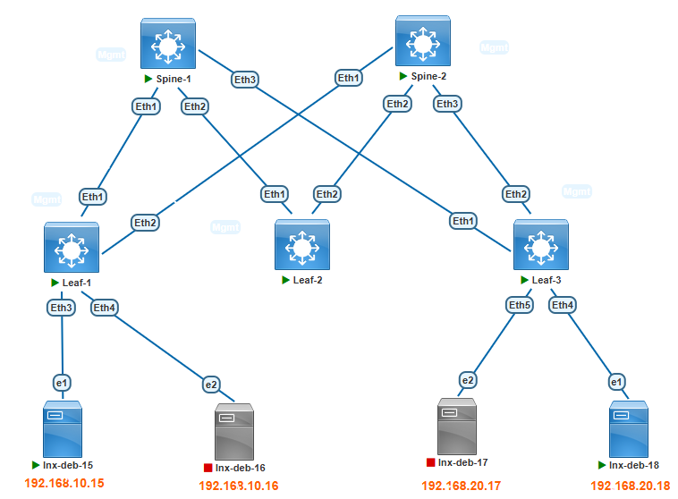

###  Задание:

  1. Разместите двух "клиентов" в разных VRF в рамках одной фабрики.
  2. Настроите маршрутизацию между клиентами через внешнее устройство (граничный роутер\фаерволл\etc)
  3. Зафиксируете в документации - план работы, адресное пространство, схему сети, конфигурацию устройств;

### Решение:

1. Сервер lnx-deb-15 подключается в Leaf1 Eth3 (Vlan 10, vrf TENENT-A, Anycast-Gateway). Сервер lnx-deb-18 подключается в Leaf3 Eth4 (Vlan 20, vrf TENENT-B, Anycast-Gateway).
2. На leaf1 - удалить всю ранее созданную конфигурацию связанной с Vlan20 (SVI, BGP etc). На leaf3 - удалить всю ранее созданную конфигурацию связанной с Vlan10 (SVI, BGP etc) и TENANT-A.
3. В качестве BGW устройства, определить Leaf2, который будет анонсировать Connected сети в фабрику, сделать на Leaf2 необходимые настройки.
4. Выполнить необходимые настройки на Leaf узлах для организации маршрутизации между сетями TENENT-A и TENENT-B.
5. Опционально. Выполнить проверку связности между сетями TENENT-A и TENENT-B узлов Leaf1/3



1. План работы
    
    1.1 Назначение IP адресов согласно ранее созданному адресному плану

        | Network IPv4     | Summary net    | Description        | Eq&port Spine/Leaf | Assigned IPs Spine/Leaf     |
        |-----------------:|:---------------|:------------------:|--------------------|-----------------------------|
        | 10.10.1.0/30     | 10.10.0.0/16   | P2P Spine1-Leaf1   | Eth1-Eth1          | 10.10.1.1/10.10.1.2         |
        | 10.10.11.0/30    | 10.10.0.0/16   | P2P Spine2-Leaf1   | Eth1-Eth2          | 10.10.11.1/10.10.11.2       |
        | 10.10.2.0/30     | 10.10.0.0/16   | P2P Spine1-Leaf2   | Eth2-Eth1          | 10.10.2.1/10.10.2.2         |
        | 10.10.12.0/30    | 10.10.0.0/16   | P2P Spine2-Leaf2   | Eth2-Eth2          | 10.10.12.1/10.10.12.2       |
        | 10.10.3.0/30     | 10.10.0.0/16   | P2P Spine1-Leaf3   | Eth3-Eth1          | 10.10.3.1/10.10.3.2         |
        | 10.10.13.0/30    | 10.10.0.0/16   | P2P Spine2-Leaf3   | Eth3-Eth2          | 10.10.13.1/10.10.13.2       |

      Третий октет подразумевает номер Leaf коммутатора. Если видим в третьем октете единицу, то это подключение Leaf1 к Spine1.
      Если видим в третьем октете 11, то это подключение Leaf1 к Spine2 и т.д.

      Таблица сетей для назначения на Loopback интерфейсы:

        | Network IPv4      | Summary net    | Description        | Assigned           |
        |------------------:|:---------------|:------------------:|--------------------|
        | 1.1.1.1/32        | 1.1.1.0/24     | Loopback0          | Leaf1              |
        | 1.1.1.2/32        | 1.1.1.0/24     | Loopback0          | Leaf2              |
        | 1.1.1.3/32        | 1.1.1.0/24     | Loopback0          | Leaf3              |
        | 100.100.100.100/32|       -        | Loopback0          | Spine1             |
        | 200.200.200.200/32|       -        | Loopback0          | Spine2             |

      Таблица номеров автономных систем BGP для каждого устройства:
         
         | Device             | Router-ID        | AS Number    |
         |--------------------|-----------------:|--------------|
         | Spine1             | 10.10.1.1        | 65100        |
         | Spine2             | 10.10.11.1       | 65100        |
         | Leaf1              | 1.1.1.1          | 65001        |
         | Leaf2              | 1.1.1.2          | 65002        |
         | Leaf3              | 1.1.1.3          | 65003        |

      Хосты подключенные к фабрике:

        | Hostname      | Ip Address       | VLAN/VNI    | Connect to interface  | MAC Address    |
        |--------------:|:-----------------|:-----------:|-----------------------|----------------|
        | lnx-deb-15    | 192.168.10.15/24 | 10/10010    | Leaf1 Eth3            | 50bb.4401.5f01 |
        | lnx-deb-16    | 192.168.10.16/24 | 10/10010    | Leaf2 Eth3/Leaf1 Eth4 | 50de.a401.6001 |
        | lnx-deb-17    | 192.168.20.17/24 | 20/10020    | Leaf3 Eth5/Leaf2 Eth5 | 50ec.6b01.6101 |
        | lnx-deb-18    | 192.168.20.18/24 | 20/10020    | Leaf3 Eth4            | 5040.dd01.6201 |
 
    


2. На leaf1 - удалить всю ранее созданную конфигурацию связанной с Vlan20 (SVI, BGP etc). На leaf3 - удалить всю ранее созданную конфигурацию связанной с Vlan10 (SVI, BGP etc) и TENANT-A.
Leaf1:
```
Leaf-1(config)# no int vlan 20
Leaf-1(config)# interface Vxlan1
Leaf-1(config-if-Vx1)# no vxlan vlan 20 vni 10020
Leaf-1(config-if-Vx1)# router bgp 65001
Leaf-1(config-router-bgp)# no vlan 20
```
Leaf3:
```
Leaf-3(config)# no int vlan 10
Leaf-3(config)# interface Vxlan1
Leaf-3(config-if-Vx1)# no vxlan vlan 10 vni 10010
Leaf-3(config)# router bgp 65003
Leaf-3(config-router-bgp)# no vlan 10
Leaf-3(config-router-bgp)# no vrf TENANT-A
```

3. В качестве BGW устройства, определить Leaf2, который будет анонсировать Connected сети в фабрику, сделать на Leaf2 необходимые настройки.

Leaf2:
```
Leaf-2(config)# router bgp 65002
Leaf-2(config-router-bgp)# vrf TENANT-A
Leaf-2(config-router-bgp-vrf-TENANT-A)# redistribute connected
```

4. Выполнить необходимые настройки на Leaf узлах для организации маршрутизации между сетями TENENT-A и TENENT-B.

Leaf3:
```
Leaf-3(config)# vrf instance TENANT-B
Leaf-3(config-vrf-TENANT-B)# ip routing vrf TENANT-B
Leaf-3(config)# no interface vlan 20
Leaf-3(config)# interface Vlan20
Leaf-3(config-if-Vl20)# vrf TENANT-B
Leaf-3(config-if-Vl20)# ip address virtual 192.168.20.1/24

Leaf-3(config)# router bgp 65003
Leaf-3(config-router-bgp)# vrf TENANT-B
Leaf-3(config-router-bgp-vrf-TENANT-B)# rd 1.1.1.3:50001
Leaf-3(config-router-bgp-vrf-TENANT-B)# route-target import evpn 65100:50001
Leaf-3(config-router-bgp-vrf-TENANT-B)# route-target export evpn 65100:50001
```

5. Проверка доступности между хостами. Так как Ping это двухсторонняя проверка, то достаточно провести тест с одного хоста и пропинговать удаленный:
```
root@lnx-deb-15:~# ip addr show dev ens4
3: ens4: <BROADCAST,MULTICAST,UP,LOWER_UP> mtu 1500 qdisc fq_codel state UP group default qlen 1000
    link/ether 50:bb:44:01:5f:01 brd ff:ff:ff:ff:ff:ff
    altname enp0s4
    inet 192.168.10.15/24 scope global ens4
       valid_lft forever preferred_lft forever
    inet6 fe80::52bb:44ff:fe01:5f01/64 scope link
       valid_lft forever preferred_lft forever


root@lnx-deb-15:~# ping 192.168.20.18 -c 3
PING 192.168.20.18 (192.168.20.18) 56(84) bytes of data.
64 bytes from 192.168.20.18: icmp_seq=1 ttl=62 time=20.7 ms
64 bytes from 192.168.20.18: icmp_seq=2 ttl=62 time=18.2 ms
64 bytes from 192.168.20.18: icmp_seq=3 ttl=62 time=17.5 ms

--- 192.168.20.18 ping statistics ---
3 packets transmitted, 3 received, 0% packet loss, time 2003ms
rtt min/avg/max/mdev = 17.492/18.800/20.662/1.352 ms
```

Проверка маршрутов EVPN type-5 и таблицы маршрутизации VRF TENANT-A/TENANT-B:

Leaf-1:
```
Leaf-1#sh ip route vrf TENANT-A

Gateway of last resort is not set

 C        192.168.10.0/24 is directly connected, Vlan10
 B E      192.168.20.0/24 [200/0] via VTEP 1.1.1.2 VNI 50001 router-mac 50:cb:43:fc:98:ec local-interface Vxlan1

Leaf-1#sh bgp evpn route-type ip-prefix 192.168.20.0/24
BGP routing table information for VRF default
Router identifier 1.1.1.1, local AS number 65001
BGP routing table entry for ip-prefix 192.168.20.0/24, Route Distinguisher: 1.1.1.2:50001
 Paths: 2 available
  65100 65002
    1.1.1.2 from 100.100.100.100 (10.10.1.1)
      Origin IGP, metric -, localpref 100, weight 0, tag 0, valid, external, ECMP head, ECMP, best, ECMP contributor
      Extended Community: Route-Target-AS:65100:50001 TunnelEncap:tunnelTypeVxlan EvpnRouterMac:50:cb:43:fc:98:ec
      VNI: 50001
  65100 65002
    1.1.1.2 from 200.200.200.200 (10.10.11.1)
      Origin IGP, metric -, localpref 100, weight 0, tag 0, valid, external, ECMP, ECMP contributor
      Extended Community: Route-Target-AS:65100:50001 TunnelEncap:tunnelTypeVxlan EvpnRouterMac:50:cb:43:fc:98:ec
      VNI: 50001
```

leaf3:
```
Leaf-3#sh ip route vrf TENANT-B

Gateway of last resort is not set

 B E      192.168.10.0/24 [200/0] via VTEP 1.1.1.2 VNI 50001 router-mac 50:cb:43:fc:98:ec local-interface Vxlan1
 C        192.168.20.0/24 is directly connected, Vlan20

Leaf-3#sh bgp evpn route-type ip-prefix 192.168.10.0/24
BGP routing table information for VRF default
Router identifier 1.1.1.3, local AS number 65003
BGP routing table entry for ip-prefix 192.168.10.0/24, Route Distinguisher: 1.1.1.2:50001
 Paths: 2 available
  65100 65002
    1.1.1.2 from 200.200.200.200 (10.10.11.1)
      Origin IGP, metric -, localpref 100, weight 0, tag 0, valid, external, ECMP head, ECMP, best, ECMP contributor
      Extended Community: Route-Target-AS:65100:50001 TunnelEncap:tunnelTypeVxlan EvpnRouterMac:50:cb:43:fc:98:ec
      VNI: 50001
  65100 65002
    1.1.1.2 from 100.100.100.100 (10.10.1.1)
      Origin IGP, metric -, localpref 100, weight 0, tag 0, valid, external, ECMP, ECMP contributor
      Extended Community: Route-Target-AS:65100:50001 TunnelEncap:tunnelTypeVxlan EvpnRouterMac:50:cb:43:fc:98:ec
      VNI: 50001
```

[Конфигурационные файлы](configs/)